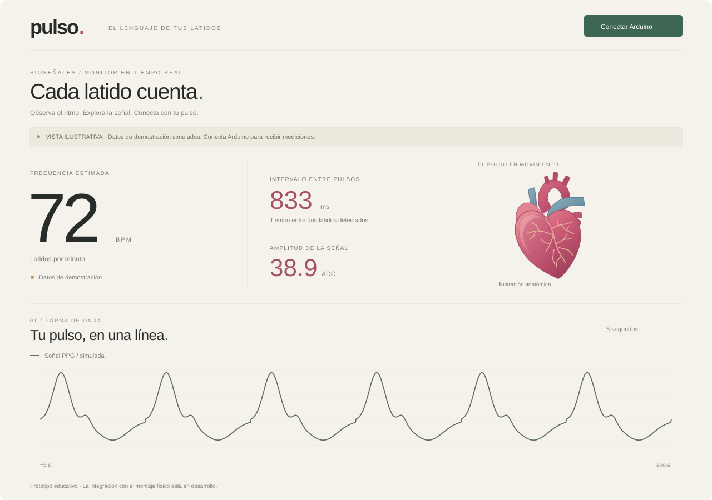

# Pulso · Monitor con Arduino

Una interfaz para observar bioseñales: frecuencia cardíaca estimada, intervalos entre pulsos y una gráfica PPG, con un corazón ilustrado que acompaña los eventos de pulso.

Proyecto educativo de Ingeniería Biomédica que conecta una interfaz web con datos enviados por Arduino mediante USB.



*Vista ilustrativa de la interfaz. Los valores y la señal de esta imagen son simulados.*

## Qué puedes explorar

- **Señal PPG:** gráfica con ventanas de 5, 10 o 15 segundos, cuadrícula y marcas de latido.
- **Lecturas:** BPM, intervalo entre pulsos y amplitud pico a pico de la señal.
- **Corazón animado:** ilustración sincronizada con los eventos de pulso recibidos.
- **Conexión USB:** lector Web Serial con velocidad configurable.
- **Exportación:** CSV que identifica si los datos provienen de la demo o de Arduino.
- **Modo de demostración:** permite explorar la interfaz sin conectar el montaje.

## Estado del proyecto

| Parte | Estado |
| --- | --- |
| Interfaz, gráfica y demostración | Implementadas y revisadas en navegador |
| Controles y exportación CSV | Verificados con datos de demostración |
| Lectura e interpretación del protocolo serie | Implementadas; pruebas automáticas incluidas |
| Conexión con el sensor y la OLED del montaje | Pendiente de integrar y comprobar con el hardware |
| Validación clínica | Fuera del alcance de este prototipo educativo |

La página **no incorpora todavía el programa del Arduino**. El modelo del sensor, los pines y el código de la pantalla OLED deben revisarse antes de completar la integración física.

## Ejecutar en tu equipo

Necesitas **Node.js 20 o posterior** y un navegador de escritorio compatible con Web Serial, como Chrome o Edge. No hay dependencias que instalar.

Desde la carpeta del proyecto:

```bash
npm start
```

En PowerShell de Windows también puedes usar:

```powershell
npm.cmd start
```

Abre **http://localhost:3010**. La página empieza en modo de demostración.

La [guía paso a paso para VS Code y Arduino](LEEME.md) explica la selección del puerto, los baudios y los formatos aceptados.

## Datos que espera la página

El formato recomendado es una línea JSON por muestra:

```json
{"signal":512,"bpm":72,"ibi":833,"beat":true}
```

| Campo | Significado |
| --- | --- |
| `signal` | Señal enviada por Arduino, en cuentas ADC |
| `bpm` | Estimación de pulsaciones por minuto calculada en la placa |
| `ibi` | Tiempo entre dos pulsos, en milisegundos |
| `beat` | `true` solo en la muestra donde se detecta un nuevo pulso |

Los campos no disponibles pueden omitirse. Los números del ejemplo solo muestran el formato. También se aceptan mensajes `S512`, `B72`, `Q833`, CSV y un número de señal por línea.

La gráfica aplica un suavizado ligero. El CSV conserva las muestras ADC originales e indica si hay saturación. Los BPM y el IBI se ocultan durante la saturación. El sketch puede enviar `ms` para conservar el tiempo de muestreo y `clipped: true` para indicar saturación.

## Tecnologías y estructura

**HTML · CSS · JavaScript · Canvas 2D · SVG · Web Serial · Node.js**

| Archivo | Función |
| --- | --- |
| `dist/index.html` | Interfaz e ilustración SVG del corazón |
| `dist/styles.css` | Diseño y adaptación a distintos tamaños de pantalla |
| `dist/app.js` | Visualización, demostración, USB y exportación |
| `dist/protocol.js` | Interpretación y reconstrucción de mensajes serie |
| `server.mjs` | Servidor local sin dependencias |
| `tests/protocol.test.mjs` | Pruebas de formatos válidos, entradas inválidas y fragmentación USB |

La carpeta `dist/` contiene el código web del proyecto y se incluye intencionalmente en el repositorio.

## Comprobar el lector de datos

```bash
npm test
```

En PowerShell: `npm.cmd test`.

## Alcance

Este es un prototipo para aprender y observar señales. **PPG no es ECG**: el sensor observa variaciones ópticas en el dedo. El corazón y su vía de conducción son ilustrativos; no representan una medición anatómica ni la fuerza de contracción.

El proyecto no debe utilizarse para diagnóstico o decisiones médicas.

Documentación técnica: [Web Serial API](https://developer.chrome.com/docs/capabilities/serial).
